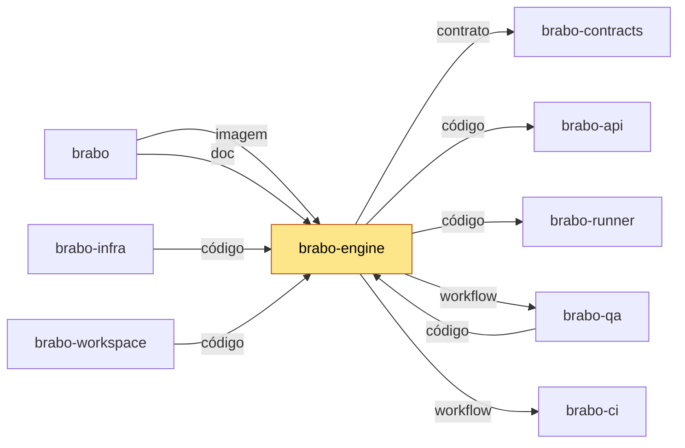

# brabo-engine

[](https://github.com/viralabs-dev/brabo-engine/actions/workflows/ci.yml?query=branch%3Adev)
[](https://github.com/viralabs-dev/brabo-engine/actions/workflows/ci.yml?query=branch%3Amain)
[](https://github.com/viralabs-dev/brabo-engine/tags)
[](https://github.com/viralabs-dev/brabo-engine/releases/latest)
[](LICENSE)
[](https://viralabs-dev.github.io/brabo/prd/)
[](https://ko-fi.com/daneiel)

Roda os agentes do Brabo sob controle: cada chamada de modelo ou ferramenta passa por um Harness, e os gates dizem se o trabalho pode avançar.

## Para que existe

O Brabo tem agentes que leem e escrevem o projeto do usuário. Eles precisam de um lugar que controle o que podem fazer, guarde o estado da conversa e encaminhe as ações à máquina certa. Esse lugar é este repositório. A api guarda o domínio; o engine executa. Os dois conversam por eventos no Postgres e por HTTP interno com service token.

Quatro peças moram aqui:

- **Agentes (Harness):** agentes rodam sempre dentro de um Harness. Nenhuma chamada de modelo ou ferramenta acontece fora dele.
- **Sessões:** a sessão é uma máquina de estados explícita (`created → active → closing → closed | closed_abnormally`). Sessão encerrada recusa nova conversa.
- **Gates:** cada gate dá um veredito ao consumidor, sem expor a estrutura interna da área que o julgou.
- **Runner-router:** entrega os comandos de terminal e de git do projeto ao `brabo-runner` da máquina do usuário, e recusa com `runner_offline` quando ele não está pronto.

As filas são Oban no Postgres, e os canais são Phoenix.

## Onde se encaixa

O engine executa os agentes e fala com os runners. Quem muda o engine muda o que os agentes fazem, por isso os contratos e a política de PR vêm de fora, fixados por tag ou SHA.

<!-- mapa:inicio -->
<!-- Gerado do repos.yml do brabo por brabo-ci:scripts/ci/mapa-dos-repos.ts. Não edite à mão. -->

**brabo-engine** — Engine (Elixir/OTP, Phoenix, Oban) — agentes, sessões, gates e roteamento de runners. Imagem publicada por tag, usada pelo brabo e pelo brabo-infra.

| repo | propósito | como é usado | depende de | é usado por |
|---|---|---|---|---|
| [brabo](https://github.com/viralabs-dev/brabo) | Porta de entrada do produto — documentação agregada, site, instalador e release. | Quem instala usa o `install.sh` e as imagens e o binário das tags de `componentes.json`; o brabo-infra o clona nas aferições cruzadas. | brabo-api (imagem, doc), brabo-engine (imagem, doc), brabo-web (imagem, doc), brabo-broker (imagem, doc), brabo-runner (imagem, doc), brabo-infra (imagem, código, doc), brabo-contracts (contrato, doc), brabo-ci (doc, workflow), brabo-qa (doc) | brabo-ci (contrato), brabo-infra (código), brabo-workspace (código) |
| [brabo-api](https://github.com/viralabs-dev/brabo-api) | API do produto (NestJS, Drizzle, PostgreSQL/pgvector) — schema, RBAC, LLM, metering e gates. | Imagem publicada por tag e consumida pelo brabo e pelo brabo-infra; o brabo-web, o brabo-engine e o brabo-qa leem o código ou o `openapi.json` dele. | brabo-contracts (contrato), brabo-infra (código), brabo-qa (workflow), brabo-ci (workflow) | brabo (imagem, doc), brabo-engine (código), brabo-web (contrato), brabo-contracts (contrato), brabo-infra (código), brabo-qa (código), brabo-workspace (código) |
| **brabo-engine** | Engine (Elixir/OTP, Phoenix, Oban) — agentes, sessões, gates e roteamento de runners. | Imagem publicada por tag, usada pelo brabo e pelo brabo-infra. | brabo-contracts (contrato), brabo-api (código), brabo-runner (código), brabo-qa (workflow), brabo-ci (workflow) | brabo (imagem, doc), brabo-infra (código), brabo-qa (código), brabo-workspace (código) |
| [brabo-web](https://github.com/viralabs-dev/brabo-web) | Interface web (React 19, Vite) — telas, i18n e design system. | Imagem publicada por tag, usada pelo brabo e pelo brabo-infra. | brabo-contracts (contrato), brabo-api (contrato), brabo-qa (workflow), brabo-ci (workflow) | brabo (imagem, doc), brabo-infra (código), brabo-qa (código), brabo-workspace (código) |
| [brabo-runner](https://github.com/viralabs-dev/brabo-runner) | CLI `brabo-runner` na máquina do usuário — PTY, container local e espelho. | Binário publicado por tag, instalado pelo brabo; o brabo-engine e o brabo-qa leem o código dele nos testes. | brabo-contracts (contrato), brabo-ci (workflow) | brabo (imagem, doc), brabo-engine (código), brabo-infra (código), brabo-qa (código), brabo-workspace (código) |
| [brabo-broker](https://github.com/viralabs-dev/brabo-broker) | Único processo com o socket do Docker do servidor. | Imagem publicada por tag, usada pelo brabo e pelo brabo-infra. | brabo-contracts (contrato), brabo-qa (workflow), brabo-ci (workflow) | brabo (imagem, doc), brabo-infra (código), brabo-qa (código), brabo-workspace (código) |
| [brabo-contracts](https://github.com/viralabs-dev/brabo-contracts) | Contratos compartilhados — os pacotes `shared` e `docker-port`, `areas.json` e `fluxo.yml`. | Consumido por TAG (pacote no GitHub Packages ou arquivo baixado por raw na mesma tag); uma tag nova pede bump em api, web, runner, broker, engine, qa e infra. | brabo-api (contrato), brabo-ci (workflow) | brabo (contrato, doc), brabo-api (contrato), brabo-engine (contrato), brabo-web (contrato), brabo-runner (contrato), brabo-broker (contrato), brabo-infra (código), brabo-qa (contrato), brabo-workspace (código) |
| [brabo-ci](https://github.com/viralabs-dev/brabo-ci) | Workflows reutilizáveis e a política de PR, escada de aprovação, promoção, tag e Dependabot. | Cada repo chama `uses: viralabs-dev/brabo-ci/...@<sha>`, fixado por SHA. | brabo-qa (contrato, workflow), brabo (contrato) | brabo (doc, workflow), brabo-api (workflow), brabo-engine (workflow), brabo-web (workflow), brabo-runner (workflow), brabo-broker (workflow), brabo-contracts (workflow), brabo-infra (workflow), brabo-qa (workflow), brabo-workspace (código, workflow) |
| [brabo-infra](https://github.com/viralabs-dev/brabo-infra) | Composes, Dockerfiles de integração, `deploy/k8s`, scripts de dev, release e cadeia de suprimentos. | O brabo clona o brabo-infra no ref de `componentes.json` para subir a instalação; o brabo-api e o brabo-qa o clonam no CI. | brabo-api (código), brabo-engine (código), brabo-web (código), brabo-broker (código), brabo-runner (código), brabo-contracts (código), brabo (código), brabo-qa (workflow), brabo-ci (workflow) | brabo (imagem, código, doc), brabo-api (código), brabo-qa (código), brabo-workspace (código) |
| [brabo-qa](https://github.com/viralabs-dev/brabo-qa) | E2E de navegador (Playwright), golden-sets e catálogo de funcionalidades — o portão da `main`. | O brabo-ci dispara o `e2e-pr` dele e lê o `funcionalidades.yml`; api, engine, web, broker e infra o chamam como portão. | brabo-api (código), brabo-engine (código), brabo-web (código), brabo-runner (código), brabo-broker (código), brabo-infra (código), brabo-contracts (contrato), brabo-ci (workflow) | brabo (doc), brabo-api (workflow), brabo-engine (workflow), brabo-web (workflow), brabo-broker (workflow), brabo-ci (contrato, workflow), brabo-infra (workflow), brabo-workspace (código) |
| [brabo-workspace](https://github.com/viralabs-dev/brabo-workspace) | Pasta-mãe `~/dev/brabo/` com os clones lado a lado e o `clonar-tudo.sh`. | Quem desenvolve roda `clonar-tudo.sh` uma vez; as sessões do Claude abrem nela. | brabo (código), brabo-api (código), brabo-engine (código), brabo-web (código), brabo-runner (código), brabo-broker (código), brabo-contracts (código), brabo-ci (código, workflow), brabo-infra (código), brabo-qa (código) | — |


<!-- mapa:fim -->

## Como é usado

O canal é a imagem de container, publicada por tag. A tag final (`vX.Y.Z`) nasce quando o dono promove a `dev` para a `main`, e a imagem sai com o mesmo nome. O `brabo` e o `brabo-infra` usam essa imagem. Este repo não publica pacote nem binário.

```sh
docker pull ghcr.io/viralabs-dev/brabo-engine:v2.1.0
```

O digest e a tag ficam no `imagem.json` anexado à Release, que é o que o `brabo` lê para montar o `images.json`.

## Como desenvolver

Stack: Elixir/OTP com Phoenix (canais) e Oban. As versões são as do `Dockerfile` e do CI: Elixir 1.20.4 e OTP 29.1.1 sobre Alpine (ADR 0209). Precisa também de Postgres 16 com pgvector e de Node 26.10.0, que o CI usa no piso de cobertura.

Os testes dos gates usam `gitleaks`, `hadolint`, `yamllint` e `actionlint`, nas versões do `ci.yml`. Sem eles esses testes são excluídos, e o CI reprova exclusão. Os testes que conferem espelho com a api e com o runner leem os clones irmãos (`BRABO_API_DIR` e `BRABO_RUNNER_DIR`, ou `../brabo-api` e `../brabo-runner`); sem eles, 4 testes falham por ambiente.

```sh
mix deps.get
mix format --check-formatted
mix compile --warnings-as-errors
POSTGRES_HOST=localhost POSTGRES_USER=brabo POSTGRES_PASSWORD=brabo mix test --cover
```

Use um Postgres descartável, nunca o da sua instalação. O trabalho nasce de `dev`, e toda mudança entra por PR. Tag só nasce de workflow.

Os contratos (`contracts/`: `areas.json`, `fluxo.yml`, `docker-cli.json`) vêm do [brabo-contracts](https://github.com/viralabs-dev/brabo-contracts) na tag fixada em `scripts/baixar-contratos.sh` (hoje `v1.2.0`). Para atualizar, rode `scripts/baixar-contratos.sh <tag>`. O CI baixa de novo e reprova divergência.

## O que o CI garante

Reprovam a PR:

- **politica** (`politica.yml`): a forma da PR (nome da branch, origem e destino) e as aprovações da escada, pelo brabo-ci.
- **Lint, contratos e Dockerfiles** (`ci.yml`): `mix format --check-formatted`, `contracts/` igual à tag fixada, versões dos scanners iguais às do `Dockerfile` e hadolint no `Dockerfile`.
- **Testes do engine** (`ci.yml`): ExUnit contra um Postgres de serviço, `compile --warnings-as-errors`, nenhum teste excluído e o piso de cobertura.
- **Build da imagem** (`ci.yml`): constrói sem publicar. Na PR para `dev`, e na PR `hotfix/*` para `main`, publica a imagem `sha-<12>` assinada, e o Trivy reprova HIGH ou CRITICAL que tenha correção.
- **E2E do brabo-qa** (`qa-e2e.yml`): na PR para `main`, roda o catálogo inteiro e bloqueia, salvo `/qa-aceitar`. Na PR para `dev`, o regressivo só atesta.

Informativos, não bloqueiam:

- **cadeia** (actionlint e pins) e **Contracts alinhado**, do `ci.yml`.
- **refs** (`refs.yml`): confere as refs `caminho:N` das regras de negócio.
- **readme** (`readme.yml`): confere o esqueleto deste README e o bloco "Onde se encaixa".
- **dependencias** (`dependencias.yml`): espera as PRs citadas em `Depende-de:`. Nunca reprova o job.

## Documentação

- [docs/business-rules/engine.md](docs/business-rules/engine.md): o índice das regras de negócio do engine; as RNs moram em partes em `docs/business-rules/engine/`, cada uma com a referência ao código e ao teste que a cobre.
- [CHANGELOG.md](CHANGELOG.md): o que mudou em cada versão.
- [CLAUDE.md](CLAUDE.md): convenções e o que o engine implementa. Também é lido por agentes de código.
- [prompts/](prompts/): os templates de prompt dos agentes.
- Site do produto: https://viralabs-dev.github.io/brabo/prd/. ADRs no repo [brabo](https://github.com/viralabs-dev/brabo).

## Como replicar no seu projeto

O engine é específico do Brabo, então não há nada para copiar inteiro. O que serve a outro projeto é o molde de imagem, que se repete nos repos que publicam imagem: o `release.yml` (build, Trivy pelo digest, assinatura cosign keyless e `imagem.json` na Release) e o `ci.yml` (lint e testes com Postgres de serviço). Adapte o nome da imagem e as versões dos scanners. O guia de adoção está em [adotar.md](https://github.com/viralabs-dev/brabo-ci/blob/dev/scripts/ci/docs/tutorials/adotar.md).

## Apoie

Se o projeto te ajuda, você pode [pagar um café no Ko-fi](https://ko-fi.com/daneiel).

## Licença

[MIT](LICENSE), com o copyright de Daniel Souza (2026).
